# WatchList

Track the shows and movies you watch — inspired by the iOS app Showline. For **macOS**, **Windows** and **Android**.

- **Up Next** — the next episode of every show you're watching; mark it watched in one click (with Undo, and an offer to mark earlier episodes too).
- **Library** — shows in Watchlist, Watch Later, Caught Up and Finished; movies in Watchlist, Watch Later and Watched; your ratings and sorting.
- **Show and movie pages** — backdrop, progress, seasons and episodes, skippable seasons, cast, where to watch in your region, trailer, collections and recommendations.
- **Scorecard** — every episode's rating in a season-by-season grid.
- **Calendar** — new episodes and movie releases as a list, a week or a month, with desktop new-episode alerts.
- **History** — watch time, episodes, shows and movies by year, a monthly chart, and editable watch dates.
- **Discover and Search** — trending, popular, airing today, in theaters, coming soon, top rated, genres; search shows, movies and people.
- **Sync with Google** — your library and history in a private Google Drive app folder, merged per item across devices.
- **In-app updates** from GitHub Releases, backups (JSON) and history export (CSV), 9 themes, 6 wallpapers (or your own picture), 8 languages.

## Screenshots

### Desktop (macOS / Windows)

| | |
|---|---|
| 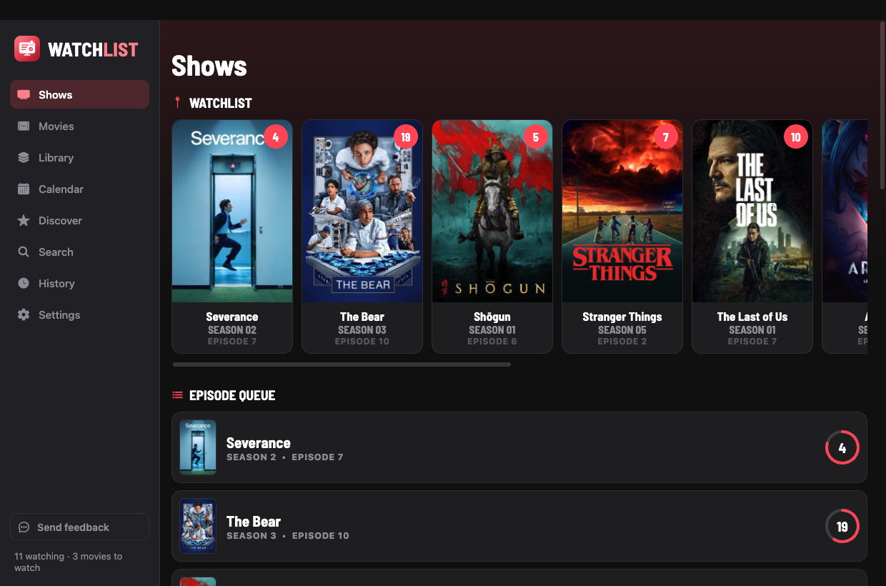 | 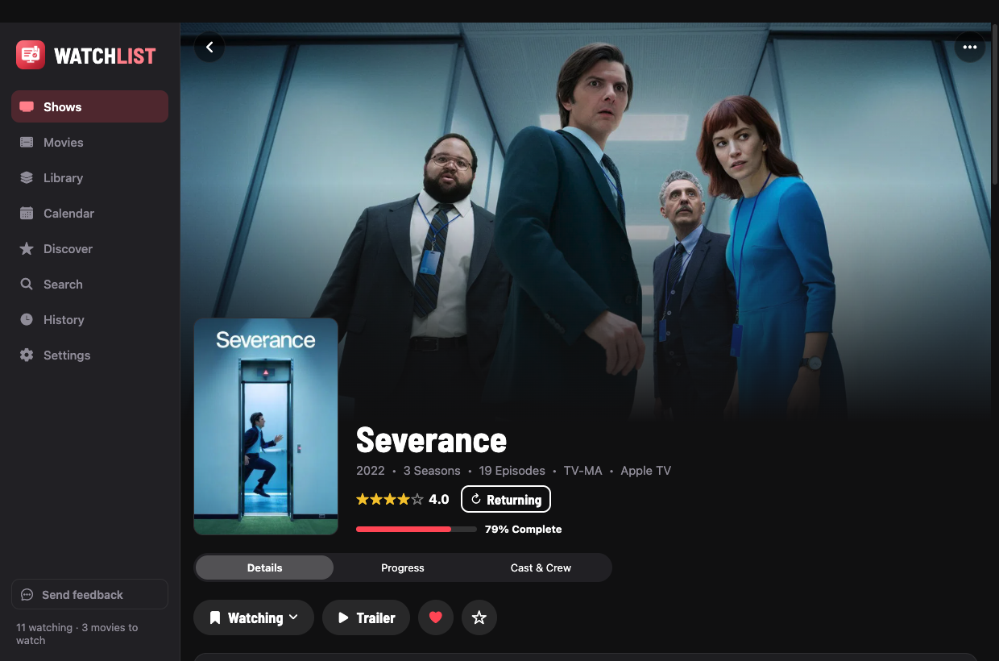 |
| 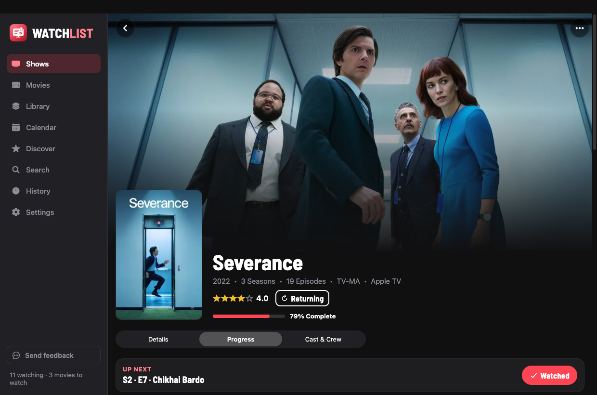 | 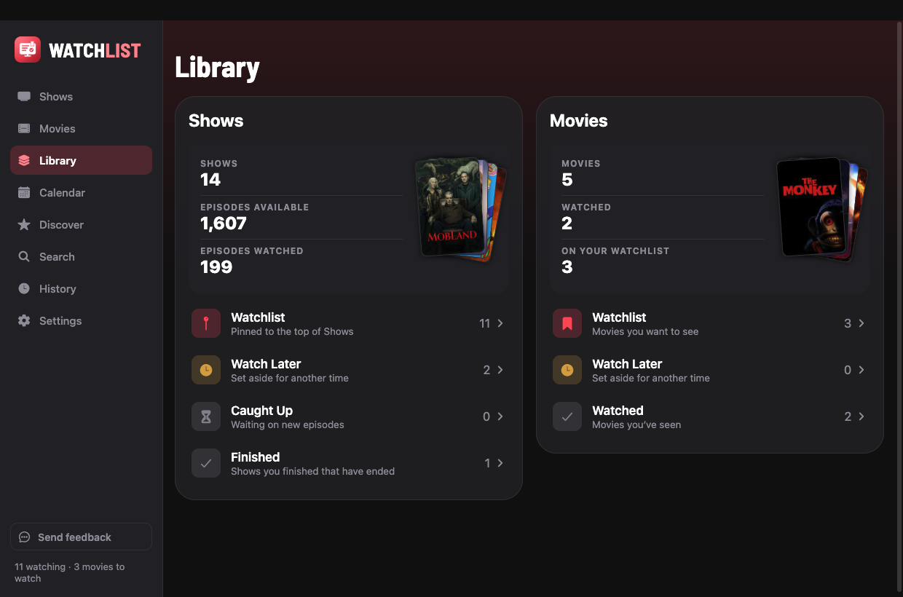 |
| 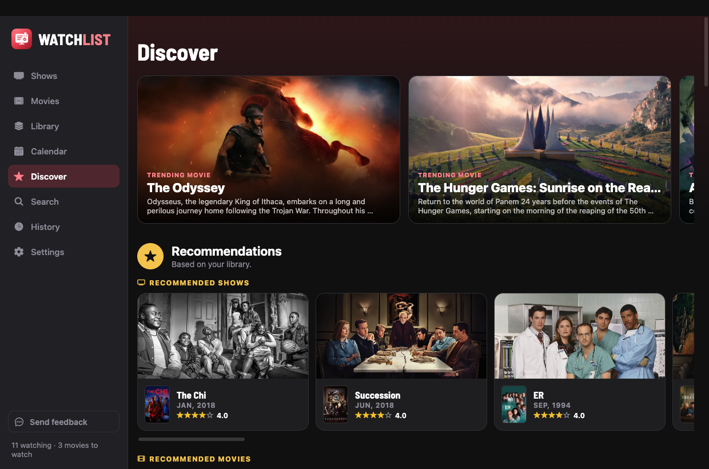 | 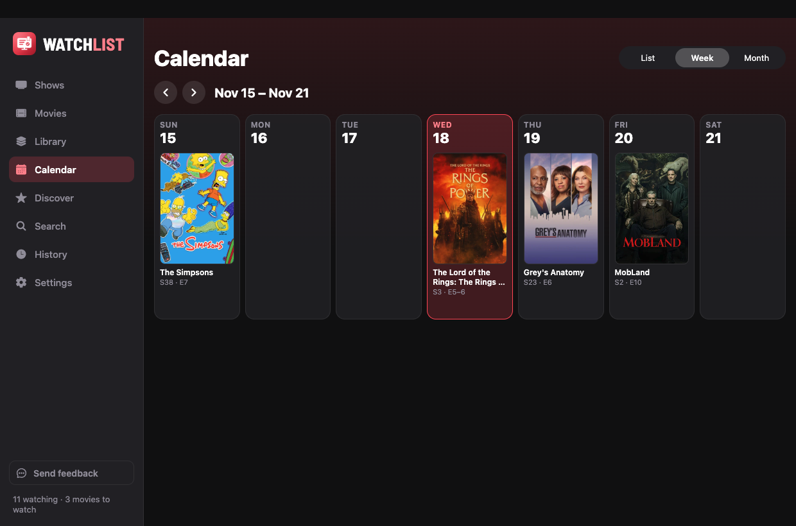 |
| 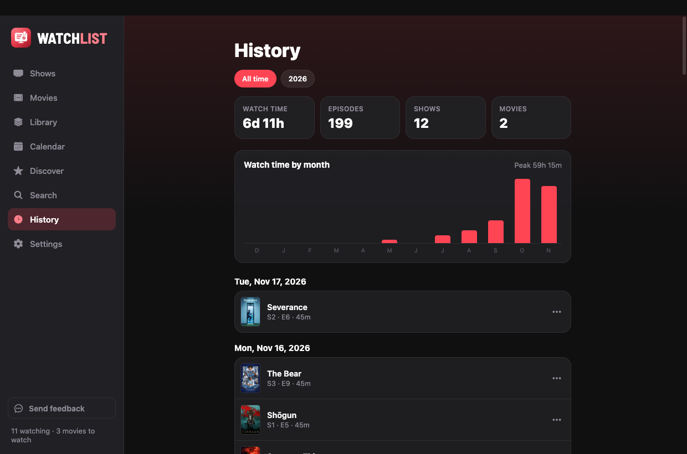 | 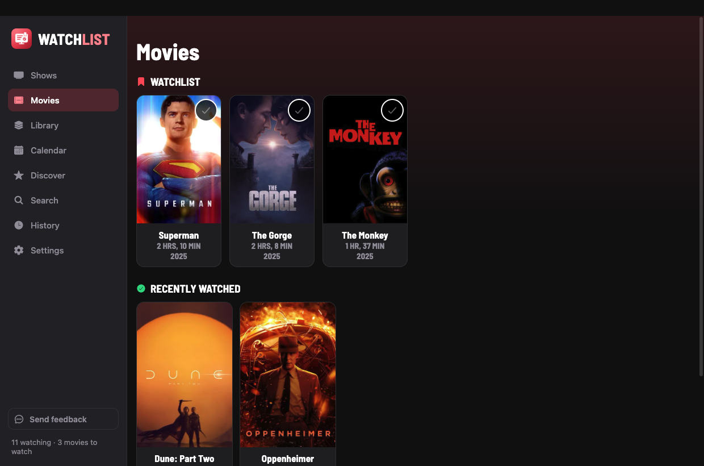 |

### Android

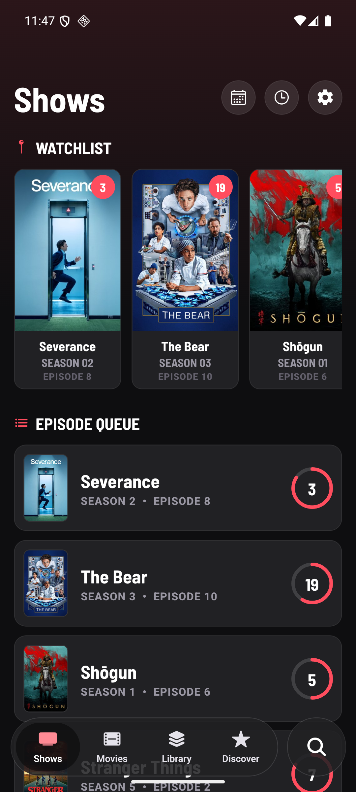 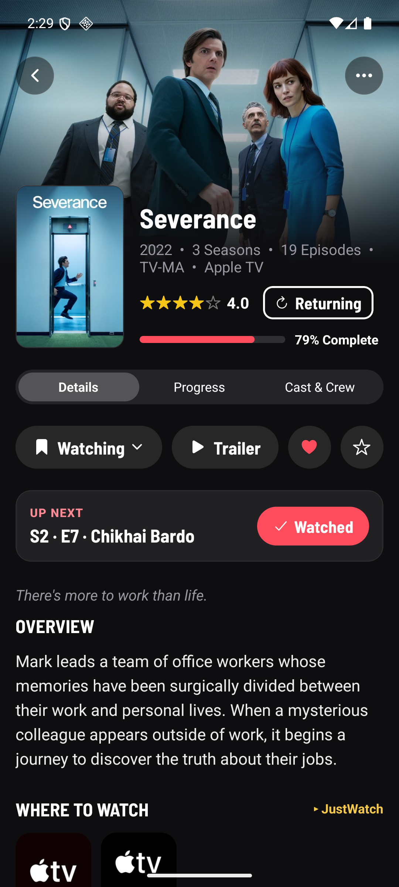 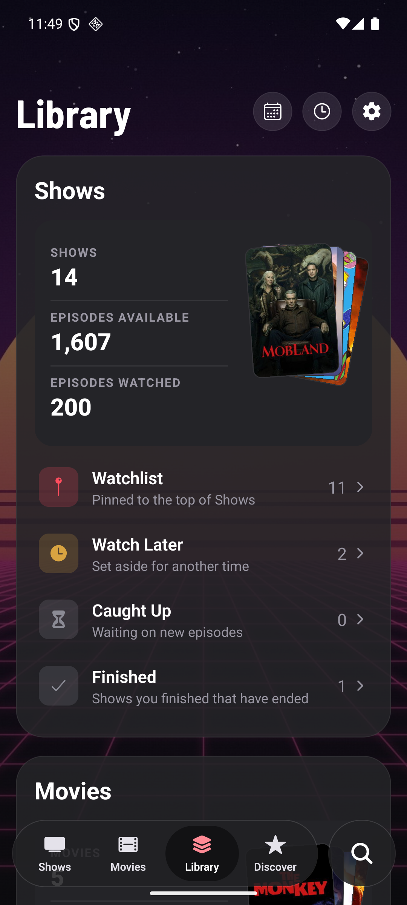 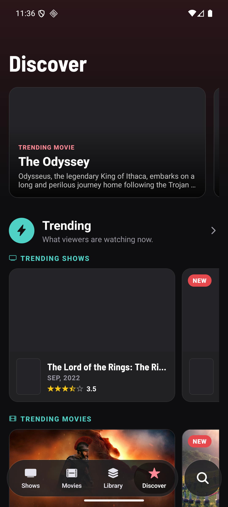

## Data sources

The same sources Showline's features come from:

- **[TMDB](https://www.themoviedb.org)** — shows, movies, seasons, episodes, people, ratings and all artwork. *This product uses the TMDB API but is not endorsed or certified by TMDB.*
- **[JustWatch](https://www.justwatch.com)** — "Where to watch" availability, through TMDB's watch-provider data.

## Development

```sh
npm install && (cd desktop && npm install)
cp .env.example .env    # add EXPO_PUBLIC_TMDB_KEY (and the Google client for Sync)
npm run dev             # Expo dev server + the desktop app, live reload
npm test && npm run typecheck
```

### TMDB

Get a free API key at themoviedb.org → Settings → API, and put either the API key or the read access token in `.env` as `EXPO_PUBLIC_TMDB_KEY`. It's built into the app.

### Sync with Google

Google Cloud project "WatchList", scope `drive.appdata` (+ email). Desktop OAuth client id/secret go in `.env` (`WATCHLIST_GOOGLE_CLIENT_ID`, `WATCHLIST_GOOGLE_CLIENT_SECRET`); Android needs an Android OAuth client with the release key's SHA-1.

## Building

```sh
npm run dist:desktop    # dist/: WatchList-<v>.dmg, WatchList-<v>-mac.zip, WatchList-Setup-<v>.exe
npx expo prebuild --platform android && npm run dist:android   # APK (release key: credentials/, passwords in ~/.gradle/gradle.properties)
npm run release         # GitHub release for package.json's version, notes from CHANGELOG.md
```

The version lives only in the root `package.json`. The updater only offers higher versions, so bump it for every release.

## License

MIT
